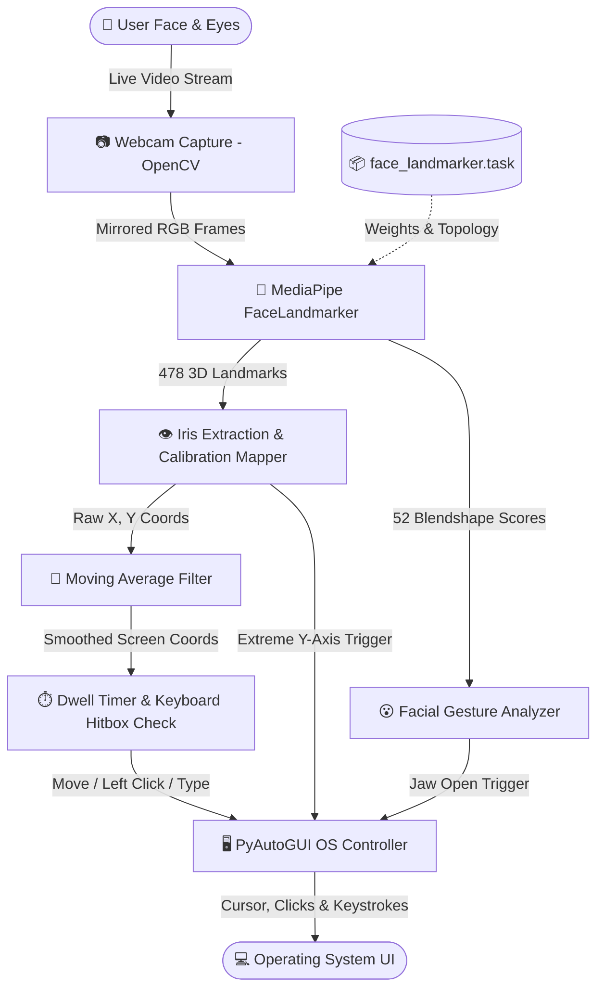
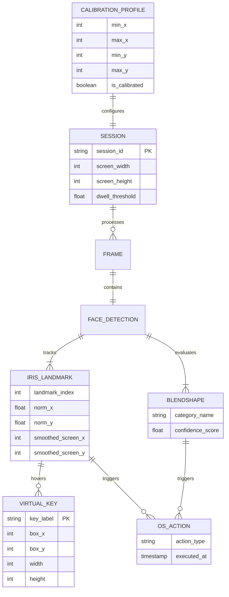

# 👁️ AI-Powered Virtual Eye Mouse & Hands-Free Keyboard


An intelligent, touchless Human-Computer Interaction (HCI) system that empowers users to control their operating system cursor, execute clicks, scroll web pages, and type text completely hands-free using real-time eye iris tracking and facial gestures via a standard webcam.

---

## 📑 Table of Contents

- [🎯 Purpose of This Project](#-purpose-of-this-project)
- [✨ Key Features](#-key-features)
- [🛠️ Requirements & Tech Stack](#️-requirements--tech-stack)
- [📂 File Structure](#-file-structure)
- [⚙️ Installation & Setup](#️-installation--setup)
- [🚀 How to Use](#-how-to-use)
- [📊 System Architecture (DFD & ER Diagrams)](#-system-architecture-dfd--er-diagrams)
- [⚖️ Pros & Cons](#️-pros--cons)
- [⚠️ Limitations, Bugs & Vulnerabilities](#️-limitations-bugs--vulnerabilities)
- [🔮 Future Updates](#-future-updates)
- [🤝 Contribute](#-contribute)
- [🙏 Thanks & Support](#-thanks--support)

---

## 🎯 Purpose of This Project

Traditional input devices like physical mice and keyboards require fine motor control of the hands and fingers. The primary purpose of this project is to:
1. **Enhance Digital Accessibility:** Provide individuals with physical disabilities, motor impairments, or paralysis an affordable, hardware-free way to navigate computers using only eye movements and facial expressions.
2. **Demonstrate Real-Time Edge AI:** Showcase how lightweight computer vision models (MediaPipe Face Landmarker) can process 478 3D facial landmarks in real time on a standard CPU without requiring specialized infrared eye-tracking hardware.
3. **Touchless Computing:** Enable hygienic, hands-free operation in sterile environments (e.g., medical labs, cleanrooms) or multitasking scenarios.

---

## ✨ Key Features

- **🎯 Dynamic 4-Second Startup Calibration:** Automatically maps your unique eye movement boundaries upon launch so cursor tracking adapts to your specific seating position and screen size.
- **🌊 Moving-Average Cursor Smoothing:** Filters out natural eye micro-jitters using a sliding coordinate history queue for smooth, fluid pointer movement.
- **⏱️ Gaze Dwell Clicking:** Triggers a **Left-Click** automatically when you hold your gaze steady on a target for 1.0 second—eliminating eye fatigue from constant blinking.
- **😮 Facial Blendshape Right-Click:** Uses MediaPipe's neural blendshape scoring (`jawOpen`) to trigger a **Right-Click** when you open your mouth.
- **📜 Gaze-Triggered Scroll Mode:** Looking toward the extreme top or bottom edges of your calibrated field of view smoothly scrolls pages up or down.
- **⌨️ Integrated On-Screen Virtual Keyboard:** Renders a live QWERTY overlay on the camera feed, allowing you to type letters, spaces, and backspaces hands-free via dwell gaze.

---

## 🛠️ Requirements & Tech Stack

### Hardware Requirements
- Standard built-in or external USB Webcam (720p or higher recommended)
- Adequate, front-facing ambient lighting
- Windows, macOS, or Linux PC/Laptop

### Software & Python Dependencies
- **Python 3.9 – 3.11**
- `opencv-python` (Video capture, frame flipping, and UI overlay rendering)
- `mediapipe` (Modern `tasks.python.vision` FaceLandmarker & Blendshapes API)
- `pyautogui` (Cross-platform OS cursor movement, clicking, scrolling, and keystrokes)
- `numpy` (Coordinate interpolation, Euclidean distance, and moving-average math)

---

## 📂 File Structure

```text
AI-powered-Virtual-Eye-Mouse/
│
├── eye_mouse.py              # Main application script (Tracking, Calibration, UI & Controls)
├── face_landmarker.task      # Pre-trained MediaPipe Face Landmarker float16 model bundle
├── requirements.txt          # Python package dependencies
└── README.md                 # Project documentation
```

---

## ⚙️ Installation & Setup

### 1. Clone the Repository
```bash
git clone https://github.com/alok--kumar8765/AI-powered-Virtual-Eye-Mouse.git
cd AI-powered-Virtual-Eye-Mouse
```

### 2. Create & Activate a Virtual Environment (Recommended)
```bash
# Windows
python -m venv env
env\Scripts\activate

# macOS / Linux
python3 -m venv env
source env/bin/activate
```

### 3. Install Required Libraries
```bash
pip install opencv-python mediapipe pyautogui numpy
```
*(Note: If you encounter a `protobuf` import conflict with TensorFlow/MediaPipe, run `pip uninstall -y protobuf && pip install protobuf`.)*

### 4. Download the MediaPipe Face Landmarker Model
Download the official `face_landmarker.task` model bundle directly into the project root directory:
```bash
curl -O https://storage.googleapis.com/mediapipe-models/face_landmarker/face_landmarker/float16/1/face_landmarker.task
```

---

## 🚀 How to Use

1. **Run the Application:**
   ```bash
   python eye_mouse.py
   ```
2. **Calibrate (First 4 Seconds):**
   - When the webcam window opens, you will see `CALIBRATING... Look around edges! (4s)`.
   - Look toward the top-left, top-right, bottom-left, and bottom-right corners of your monitor so the system records your iris range.
3. **Control Your PC:**
   - **Move Cursor:** Move your eyes naturally across the screen.
   - **Left-Click:** Hold your gaze steady on an icon or button for **1.0 second**.
   - **Right-Click:** Open your mouth (`jawOpen` gesture).
   - **Scroll Up / Down:** Glance toward the extreme top or bottom edge of your calibrated zone.
   - **Type Text:** Look at any key on the on-screen virtual keyboard overlay and hold your gaze for **1.0 second**.
4. **Exit:** Press **`q`** on your physical keyboard while the OpenCV window is focused.

---

## 📊 System Architecture (DFD & ER Diagrams)

### Data Flow Diagram (Level 1 DFD)



### Entity-Relationship (ER) Diagram



---

## ⚖️ Pros & Cons

### ✅ Pros
- **Zero Extra Hardware:** Works with any standard laptop webcam—no expensive Tobii eye trackers needed.
- **Adaptive Calibration:** Automatically adjusts to user distance and monitor resolution at startup.
- **All-in-One Input:** Combines cursor navigation, left/right clicking, scrolling, and keyboard typing in a single script.
- **CPU Friendly:** Runs smoothly in real time using MediaPipe's optimized `float16` model.

### ❌ Cons
- **Lighting Sensitive:** Low light or harsh backlighting can degrade iris landmark accuracy.
- **Head Movement Drift:** Moving your chair or shifting your head significantly after the 4-second calibration requires restarting the app to recalibrate.
- **Glasses Glare:** Thick-rimmed glasses or strong screen reflections over the pupils can occasionally interfere with iris tracking.

---

## ⚠️ Limitations, Bugs & Vulnerabilities

1. **Calibration Boundary Trapping (Known Edge Case):** If a user barely moves their eyes during the 4-second calibration window, `min_x` and `max_x` can become too narrow (or invert after the `±10` buffer), causing `np.interp` to snap the cursor to screen edges.
2. **Unintentional Midas Touch (Dwell Fatigue):** Resting your eyes on any part of the screen for more than 1 second triggers a left-click, which can inadvertently click links while reading unless you glance into the scroll zone or keep moving.
3. **PyAutoGUI Fail-Safe Trigger:** Quickly snapping the cursor to the extreme top-left corner `(0, 0)` of the monitor triggers PyAutoGUI's built-in `FailSafeException`, immediately terminating the script.
4. **Security & Privacy Considerations:**
   - **Camera Access:** The application requires continuous webcam access. All video frames are processed **100% locally in memory**—no video, images, or biometric landmark data are saved to disk or transmitted over the network.
   - **Input Injection Vulnerability:** Because `pyautogui` programmatically controls OS mouse and keyboard events, running the script in untrusted environments or leaving it unattended while active could result in accidental system inputs.

---

## 🔮 Future Updates

- [ ] **One-Euro Filter Integration:** Upgrade from a basic moving average to a speed-adaptive One-Euro Filter for zero-lag fast glances and rock-solid stillness when reading.
- [ ] **Head-Pose Compensation:** Combine 3D head orientation matrices with iris coordinates so users can move their head freely without losing calibration.
- [ ] **Pause / Resume Eye Gesture:** Add a dedicated gesture (e.g., closing both eyes for 2 seconds) to toggle "Sleep Mode" so users can read peacefully without dwell-clicking.
- [ ] **Floating Transparent HUD Overlay:** Build a sleek PyQt6 / Tkinter transparent overlay so the virtual keyboard floats directly over any application instead of inside the OpenCV camera window.
- [ ] **Audio Feedback & Voice Commands:** Add subtle click sound effects and speech-to-text dictation support.

---

## 🤝 Contribute

Contributions, issues, and feature requests are welcome! Follow these steps to contribute:

1. **Fork** the repository on GitHub.
2. **Create a new branch** for your feature or bug fix:
   ```bash
   git checkout -b feature/amazing-eye-feature
   ```
3. **Commit** your changes with clear messages:
   ```bash
   git commit -m "Add One-Euro smoothing filter"
   ```
4. **Push** to your branch:
   ```bash
   git push origin feature/amazing-eye-feature
   ```
5. Open a **Pull Request** describing your improvements.

---

## 🙏 Thanks & Support

- Special thanks to the **Google MediaPipe** and **OpenCV** open-source communities for making real-time computer vision accessible to everyone.
- Developed & maintained by **[Alok Kumar](https://github.com/alok--kumar8765)**.

⭐ **If you found this project helpful or inspiring, please give it a Star on GitHub!** It helps others discover the project and motivates further accessibility updates.