<div align="center">

# 🚀 AI, Computer Vision & Full-Stack Engineering Portfolio

[](https://github.com/alok-kumar8765)
[](https://www.python.org/)
[](https://github.com/alok-kumar8765)
[](https://github.com/alok-kumar8765)
[](https://opensource.org/licenses/MIT)

*A systematically organized monorepo housing 7 end-to-end Python applications spanning Edge AI, Affective Computing, Biometric Security, 3D WebGL Simulations, NLP Recruitment Systems, and Developer Tooling.*

</div>

---

## 🧭 Master Repository Table of Contents

- [📂 Master Monorepo File Structure](#-master-monorepo-file-structure)
- [🗂️ Quick Project Index](#️-quick-project-index)
- [1. 🎵 Expression Player (AI Emotion-Based Music Companion)](#1--expression-player-ai-emotion-based-music-companion)
- [2. 👁️ AI-Powered Virtual Eye Mouse & Hands-Free Keyboard](#2-️-ai-powered-virtual-eye-mouse--hands-free-keyboard)
- [3. 🏎️ AI Racing Track Generator & 3D Autonomous Simulation](#3-️-ai-racing-track-generator--3d-autonomous-simulation)
- [4. 🎨 Cartoon Studio Creator API & Web App](#4--cartoon-studio-creator-api--web-app)
- [5. 📄 AI-Powered Enterprise Resume Screening & ATS System](#5--ai-powered-enterprise-resume-screening--ats-system)
- [6. ✍️ AI-Powered Signature Verifier (Baseline & Multi-Sample Enterprise)](#6-️-ai-powered-signature-verifier-baseline--multi-sample-enterprise)
- [7. 📂 Struct2Project Pro (Automated Architecture Scaffolder)](#7--struct2project-pro-automated-architecture-scaffolder)
- [🤝 Contributing to This Repository](#-contributing-to-this-repository)
- [🙏 Acknowledgments & Support](#-acknowledgments--support)

---

## 📂 Master Monorepo File Structure

To keep all projects clean, isolated, and easy to run inside a single GitHub repository (`https://github.com/alok-kumar8765`), organize the root folder as follows:

```text
alok-ai-fullstack-projects/
│
├── README.md                                # Master portfolio documentation (this file)
├── LICENSE                                  # MIT License
│
├── 01-expression-player/                    # Desktop Affective Computing & Music Player
├── 02-virtual-eye-mouse/                    # Touchless HCI Iris Tracking & Virtual Keyboard
├── 03-ai-racing-simulation/                 # 3D Three.js + TensorFlow CNN Racing Simulator
├── 04-cartoon-studio-creator/               # FastAPI + Fabric.js + rembg Studio App
├── 05-enterprise-resume-screener/           # Semantic Vector ATS & OpenAI Resume Parser
├── 06-signature-verifier-suite/             # Siamese CNN Biometric Signature Verification
│   ├── baseline-single-sample/
│   └── enterprise-multi-sample-api/
└── 07-struct2project-pro/                   # Streamlit Markdown-to-Project Scaffolder
```

---

## 🗂️ Quick Project Index

| # | Project Name | Core Domain | Primary Tech Stack | Folder Path |
| :--- | :--- | :--- | :--- | :--- |
| **01** | **Expression Player** | Affective Computing & Desktop UI | Python, DeepFace, OpenCV, Pygame, Tkinter | `01-expression-player/` |
| **02** | **Virtual Eye Mouse** | Assistive HCI & Computer Vision | Python, MediaPipe, OpenCV, PyAutoGUI | `02-virtual-eye-mouse/` |
| **03** | **AI Racing Simulator** | 3D WebGL & Deep Learning | Python, TensorFlow, Flask, Three.js | `03-ai-racing-simulation/` |
| **04** | **Cartoon Studio Creator** | Generative Graphics & Full-Stack Web | FastAPI, SQLAlchemy, Fabric.js, `rembg` | `04-cartoon-studio-creator/` |
| **05** | **Enterprise Resume ATS** | Semantic NLP & HR Tech | Flask, Sentence-Transformers, OpenAI, JWT | `05-enterprise-resume-screener/` |
| **06** | **Signature Verifier Suite** | Biometric Security & Deep Learning | TensorFlow/Keras (Siamese CNN), OpenCV, Flask | `06-signature-verifier-suite/` |
| **07** | **Struct2Project Pro** | Developer Productivity & Automation | Streamlit, Python `pathlib`, `secrets`, Tkinter | `07-struct2project-pro/` |

---
---

# 1. 🎵 Expression Player (AI Emotion-Based Music Companion)


An intelligent, privacy-first desktop music player that captures real-time facial expressions via webcam, filters emotional noise using a rolling-window hysteresis debouncer, and automatically plays or adapts local music tracks to match or elevate your mood.

### 🎯 Purpose & Use Cases
- **Purpose:** Eliminate manual playlist switching during deep work, study sessions, or mood transitions by coupling local affective computing with smooth audio playback.
- **Use Cases:** Mood-adaptive desktop listening, workplace stress/break awareness, accessibility sensory audio cues, and local WebSocket emotion broadcasting for adaptive gaming.

### ✨ Key Features
- **Edge AI Emotion Inference:** Runs DeepFace locally (`Happy`, `Sad`, `Angry`, `Surprise`, `Neutral`) with zero cloud video uploads.
- **Hysteresis Debounce Engine:** Uses `collections.deque` and a configurable 3–5 second timer so blinks or yawns never cause song stuttering or restarting.
- **Multithreaded Dark GUI:** Glossy slate dark-themed Tkinter interface backed by separate daemon threads for camera capture, AI inference, and audio playback.
- **Preference Learning:** SQLite-backed `Thumbs Up 👍` / `Thumbs Down 👎` feedback system supporting both *Mood Matching* and *Mood Lifting* modes.
- **Modular Real-World Extensions:** Built-in architectural modules for Driver Fatigue Monitoring, Stress Intervention, Accessibility, and a Local Gaming JSON/WebSocket API.

### 📂 File Structure
```text
01-expression-player/
├── main.py                  # Application entry point
├── requirements.txt         # Project dependencies
├── config.json              # Thresholds, debounce timers & audio settings
├── music/                   # Categorized local MP3 folders (happy, sad, angry, surprise, neutral)
├── core/                    # webcam_manager, emotion_detector, emotion_manager, music_player, feedback_manager
├── gui/                     # main_window, webcam_panel, emotion_panel, music_panel, settings_panel
├── providers/               # local_provider & spotify_provider adapter
├── extensions/              # driver_monitor, stress_monitor, accessibility, gaming_api
├── database/                # feedback.db (SQLite) & app.log
└── tests/                   # Automated unit tests
```

### ⚙️ Requirements, Installation & Setup
- **Requirements:** Python `3.10+`, Webcam, 4GB+ RAM.
```bash
cd 01-expression-player
python -m venv env
env\Scripts\activate          # Windows (Linux/macOS: source env/bin/activate)
pip install -r requirements.txt
# Add .mp3 tracks inside music/happy/, music/sad/, music/angry/, music/surprise/, music/neutral/
python main.py
```

### 📊 System Architecture (DFD & ER Diagrams)

#### Data Flow Diagram (Level 1 DFD)
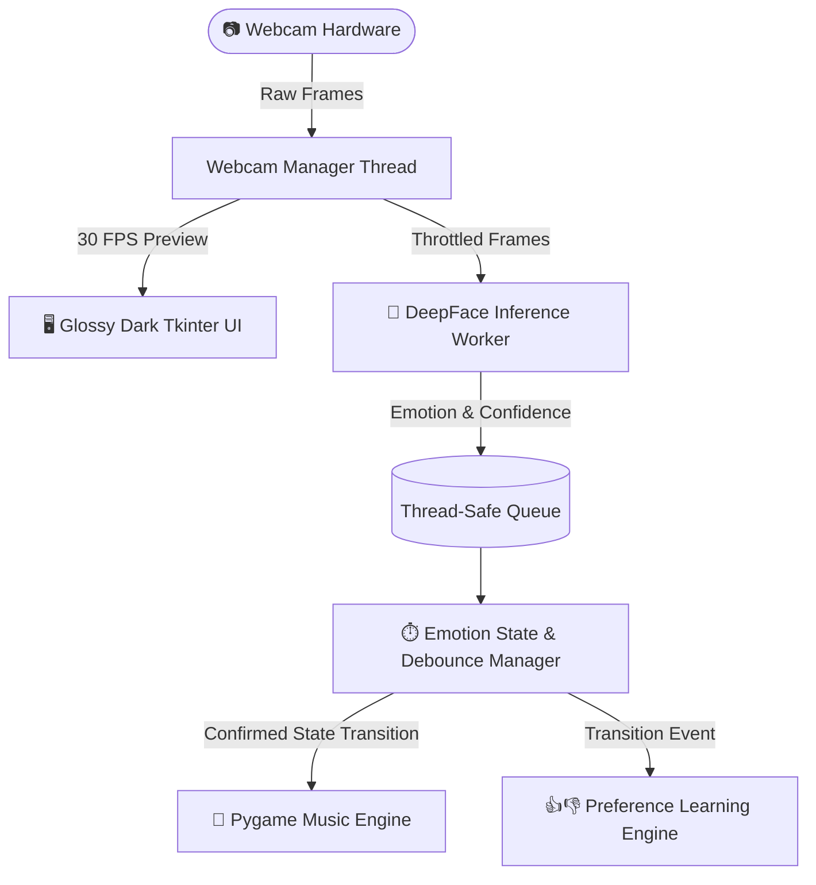

#### Entity-Relationship (ER) Diagram
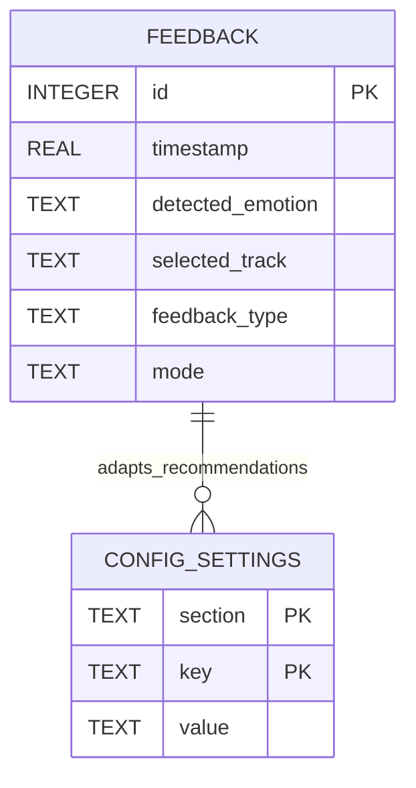

### ⚖️ Pros & Cons
| Pros ✅ | Cons ❌ |
| :--- | :--- |
| 100% local edge processing ensures complete user privacy. | DeepFace TensorFlow backend has a 2–3 second cold-start initialization time. |
| Hysteresis debouncing completely eliminates rapid song restarts. | Low ambient lighting reduces facial emotion confidence scores. |

### ⚠️ Limitations, Bugs & Vulnerabilities
- **Limitation:** Facial muscle movement is an external approximation and does not clinically diagnose internal mental states.
- **Bug/Vulnerability:** Local SQLite feedback logs (`feedback.db`) are stored unencrypted on disk; certain Linux MP3 codecs may emit Pygame console warnings.

### 🔮 Future Updates
- [ ] Full OAuth2 Spotify Web API streaming playback integration based on track valence and BPM.
- [ ] Quantized ONNX Runtime / MediaPipe model swap for ultra-low CPU usage on older laptops.

---
---

# 2. 👁️ AI-Powered Virtual Eye Mouse & Hands-Free Keyboard


A touchless Human-Computer Interaction (HCI) system that empowers users to control their OS cursor, execute clicks, scroll web pages, and type text completely hands-free using real-time eye iris tracking and facial blendshapes via a standard webcam.

### 🎯 Purpose & Use Cases
- **Purpose:** Provide individuals with motor impairments or paralysis an affordable, hardware-free way to operate a computer using only eye movements.
- **Use Cases:** Accessibility computing, sterile medical/cleanroom terminal interaction, and hands-free multitasking.

### ✨ Key Features
- **Dynamic 4-Second Calibration:** Maps your unique iris movement boundaries upon startup.
- **Moving-Average Cursor Smoothing:** Eliminates natural eye micro-jitters for fluid pointer control.
- **Gaze Dwell Left-Click & Virtual QWERTY Keyboard:** Holding gaze for `1.0s` triggers clicks or types characters on an on-screen overlay.
- **Blendshape Right-Click & Gaze Scrolling:** Opening your mouth (`jawOpen`) triggers a right-click; looking at extreme top/bottom edges scrolls pages.

### 📂 File Structure
```text
02-virtual-eye-mouse/
├── eye_mouse.py              # Tracking, 4s calibration, dwell timer & virtual keyboard UI
├── face_landmarker.task      # Pre-trained MediaPipe Face Landmarker float16 model
├── requirements.txt          # opencv-python, mediapipe, pyautogui, numpy
└── README.md
```

### ⚙️ Requirements, Installation & Setup
- **Requirements:** Python `3.9–3.11`, Webcam, front-facing lighting.
```bash
cd 02-virtual-eye-mouse
python -m venv env
env\Scripts\activate
pip install opencv-python mediapipe pyautogui numpy
curl -O https://storage.googleapis.com/mediapipe-models/face_landmarker/face_landmarker/float16/1/face_landmarker.task
python eye_mouse.py
```

### 📊 System Architecture (DFD & ER Diagrams)

#### Data Flow Diagram (Level 1 DFD)
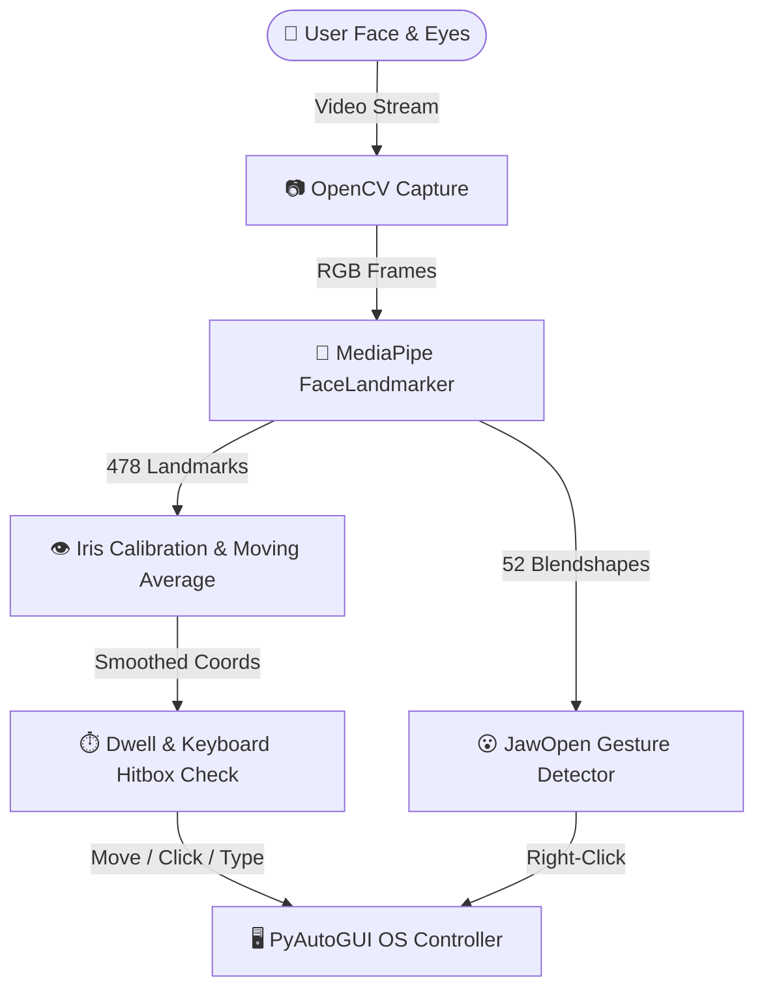

#### Entity-Relationship (ER) Diagram
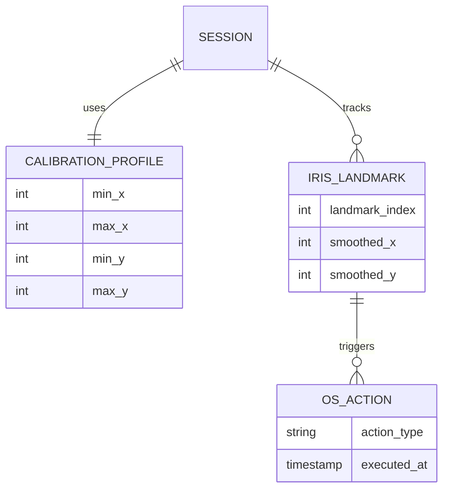

### ⚖️ Pros & Cons
| Pros ✅ | Cons ❌ |
| :--- | :--- |
| Requires zero specialized infrared eye-tracking hardware. | Significant head movement after calibration requires app restart. |
| Combines navigation, clicking, scrolling, and typing in one script. | Strong reflections on eyeglasses can interfere with pupil landmarks. |

### ⚠️ Limitations, Bugs & Vulnerabilities
- **Calibration Trapping:** Barely moving eyes during the initial 4 seconds narrows `min_x`/`max_x`, causing cursor edge snapping.
- **PyAutoGUI Fail-Safe:** Snapping the cursor to `(0, 0)` triggers `FailSafeException` and terminates the script.

### 🔮 Future Updates
- [ ] Upgrade to a speed-adaptive **One-Euro Filter** and 3D head-pose compensation.
- [ ] Add an eye-closure "Sleep Toggle" so users can read without accidental dwell clicks.

---
---

# 3. 🏎️ AI Racing Track Generator & 3D Autonomous Simulation


A full-stack 3D autonomous racing simulation combining a **Python/TensorFlow** CNN backend with an interactive **Three.js/WebGL** frontend. Procedurally generate endless race circuits via random seeds, drive manually, or toggle **AI Auto-Drive**.

### 🎯 Purpose & Use Cases
- **Purpose:** Bridge Deep Learning inference and 3D browser graphics inside a lightweight local web environment without heavy game engines.
- **Use Cases:** ML inference loop prototyping, Procedural Content Generation (PCG) demonstrations, and full-stack telemetry visualization.

### ✨ Key Features
- **Procedural 3D Track Generation:** Uses seeded trigonometry and `CatmullRomCurve3` splines to create infinite closed-loop tracks.
- **AI Auto-Drive Mode:** Hands steering over to a TensorFlow Sequential CNN (`Conv2D` $\rightarrow$ `Flatten` $\rightarrow$ `Dense` $\rightarrow$ `Softmax`).
- **Real-Time Telemetry HUD:** Live KM/H speedometer, 2D Canvas minimap, and dual keyboard (`WASD`) / on-screen controls.

### 📂 File Structure
```text
03-ai-racing-simulation/
├── app.py                  # Flask REST API, TensorFlow CNN & procedural track generator
├── templates/
│   └── index.html          # Three.js 3D renderer, vehicle physics & telemetry HUD
└── README.md
```

### ⚙️ Requirements, Installation & Setup
- **Requirements:** Python `3.9–3.11`, WebGL-enabled browser.
```bash
cd 03-ai-racing-simulation
python -m venv env
env\Scripts\activate
pip install flask tensorflow "numpy<2.0"
python app.py
# Open http://localhost:5000 in your browser
```

### 📊 System Architecture (DFD & ER Diagrams)

#### Data Flow Diagram (Level 1 DFD)
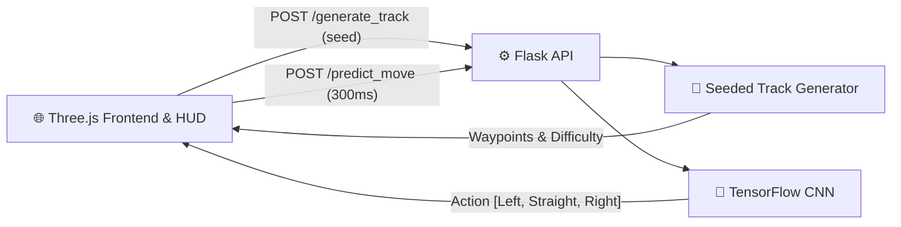

#### Entity-Relationship (ER) Diagram
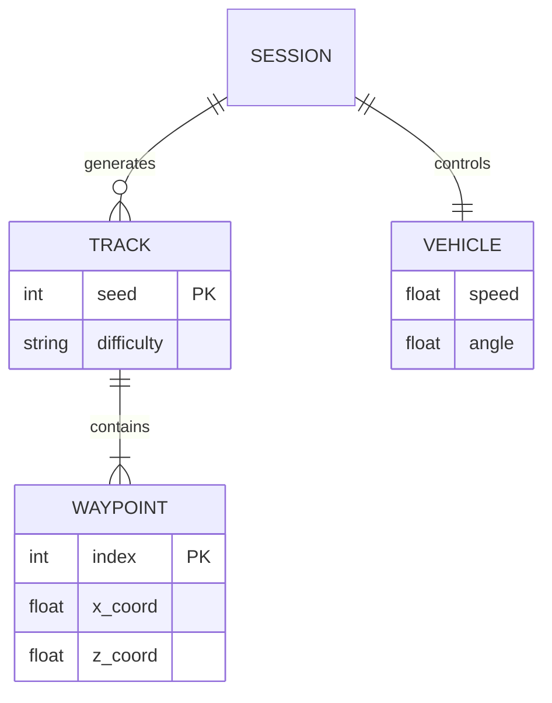

### ⚖️ Pros & Cons
| Pros ✅ | Cons ❌ |
| :--- | :--- |
| Zero heavy game engine installation required. | Uses untrained CNN weights by default (stochastic steering). |
| Infinite replayability with seeded track generation. | HTTP polling every 300ms adds latency compared to WebSockets. |

### ⚠️ Limitations, Bugs & Vulnerabilities
- **Untrained Model:** `build_ai_model()` compiles the architecture without pre-trained `.h5` weights.
- **Security Vulnerability:** `app.run(debug=True)` is enabled for local development—never expose publicly.

### 🔮 Future Updates
- [ ] Stream live WebGL `<canvas>` frames to the CNN and train via behavioral cloning.
- [ ] Upgrade HTTP polling to `Flask-SocketIO` WebSockets for 60 FPS AI steering.

---
---

# 4. 🎨 Cartoon Studio Creator API & Web App


A full-stack interactive cartoon creation studio powered by a **FastAPI** backend, **SQLAlchemy** persistence, AI background removal (`rembg`), and client-side **Fabric.js** canvas rendering.

### 🎯 Purpose & Use Cases
- **Purpose:** Provide a browser-native design canvas where users can compose characters, add speech bubbles, remove image backgrounds via AI, and export high-res PNGs.
- **Use Cases:** Educational comic storyboards, custom avatars, social media graphics, and microservice image-composition boilerplates.

### ✨ Key Features
- **AI Background Removal (`rembg`):** Automatically strips backgrounds from uploaded local photos and registers them as transparent assets.
- **Dynamic Asset Discovery:** Auto-scans `static/assets/` without hardcoded mappings.
- **Interactive Fabric.js Engine:** Supports drag, scale, rotation, z-index layering, and $2\times$ Retina PNG exports stored in SQLite.

### 📂 File Structure
```text
04-cartoon-studio-creator/
├── main.py             # FastAPI endpoints, static mounts & rembg integration
├── models.py           # SQLAlchemy ORM models
├── schemas.py          # Pydantic validation schemas
├── cartoons.db         # Auto-generated SQLite database
├── exports/            # Saved high-resolution PNG renders
├── static/assets/      # Dynamic asset repository
└── templates/index.html
```

### ⚙️ Requirements, Installation & Setup
- **Requirements:** Python `3.9+`, 4GB RAM (for `rembg` ONNX inference).
```bash
cd 04-cartoon-studio-creator
python -m venv env
env\Scripts\activate
pip install fastapi uvicorn sqlalchemy pydantic rembg pillow onnxruntime python-multipart jinja2
uvicorn main:app --reload --port 8000
# Open http://127.0.0.1:8000
```

### 📊 System Architecture (DFD & ER Diagrams)

#### Data Flow Diagram (Level 1 DFD)
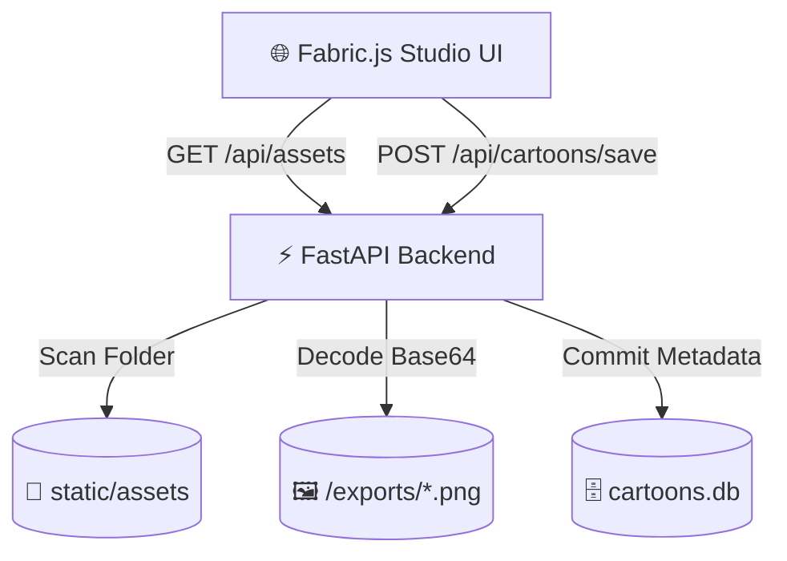

#### Entity-Relationship (ER) Diagram
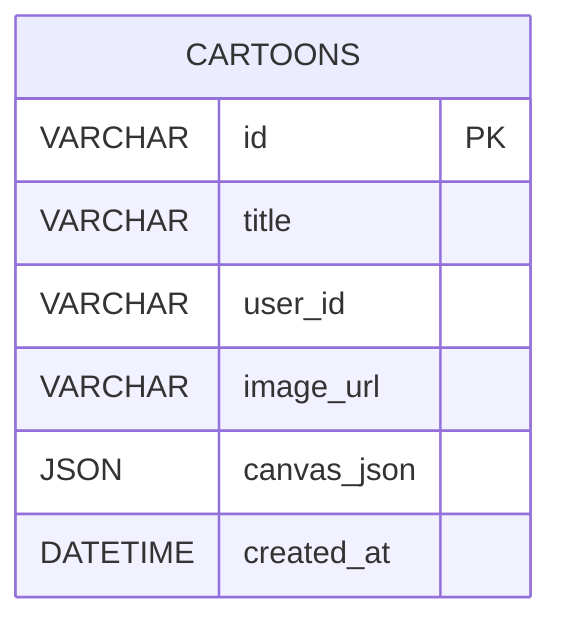

### ⚖️ Pros & Cons
| Pros ✅ | Cons ❌ |
| :--- | :--- |
| Clean FastAPI + Jinja2 monolith with zero Node.js build overhead. | Local SQLite and disk exports limit horizontal multi-server scaling. |
| Instant AI background removal built right into asset uploads. | Exports raster PNGs rather than scalable vector SVG files. |

### ⚠️ Limitations, Bugs & Vulnerabilities
- **Payload Size Risk:** High-resolution Base64 canvas payloads lack strict body size limits, risking memory spikes if flooded.
- **Orphaned Files:** Deleting database entries does not yet trigger automated garbage collection on `/exports/`.

### 🔮 Future Updates
- [ ] Migrate export storage to AWS S3 / Cloudinary and add JWT user galleries.
- [ ] Add server-side vector SVG export using `cairosvg`.

---
---

# 5. 📄 AI-Powered Enterprise Resume Screening & ATS System


An automated Applicant Tracking System (ATS) leveraging **Dense Vector Embeddings (`Sentence-Transformers`)** and **Structured LLM Extraction (`OpenAI` + `Pydantic`)** to rank candidate resumes semantically rather than relying on brittle keyword matching.

### 🎯 Purpose & Use Cases
- **Purpose:** Eliminate recruitment bottlenecks by scoring resumes based on genuine contextual fit while enforcing Role-Based Access Control (RBAC) over candidate PII.
- **Use Cases:** Enterprise HR candidate shortlisting, automated CV data extraction, and recruiter feedback-driven ranking.

### ✨ Key Features
- **Semantic Vector Matching:** Uses `all-MiniLM-L6-v2` cosine similarity to match conceptual skills (e.g., matching *"Node.js developer"* with *"Backend JS engineer"*).
- **Structured LLM Parsing:** Extracts experience, education, and skills into validated JSON schemas.
- **RBAC & Recruiter Feedback Loop:** JWT-protected endpoints with dynamic ranking boosts based on recruiter shortlisting actions and instant CSV/PDF report exports.

### 📂 File Structure
```text
05-enterprise-resume-screener/
├── app/
│   ├── __init__.py          # Flask app factory & JWT setup
│   ├── config.py            # Environment configuration
│   ├── api/                 # auth.py (RBAC) & feedback.py (CSV/PDF export)
│   └── services/            # database.py, nlp_engine.py, parser.py
├── Dockerfile
├── requirements.txt
└── .env                     # JWT_SECRET_KEY & OPENAI_API_KEY
```

### ⚙️ Requirements, Installation & Setup
- **Requirements:** Python `3.11+`, active `OPENAI_API_KEY`.
```bash
cd 05-enterprise-resume-screener
python -m venv venv
venv\Scripts\activate
pip install -r requirements.txt
# Create .env with JWT_SECRET_KEY and OPENAI_API_KEY
set FLASK_APP=app:create_app
flask run --host=0.0.0.0 --port=8000
```

### 📊 System Architecture (DFD & ER Diagrams)

#### Data Flow Diagram (Level 1 DFD)
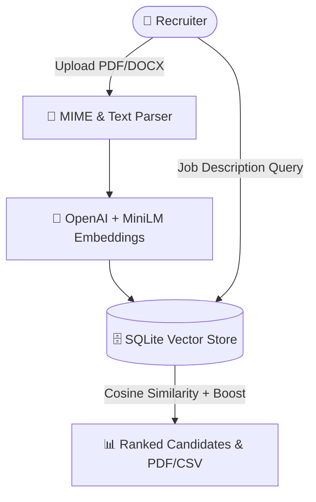

#### Entity-Relationship (ER) Diagram
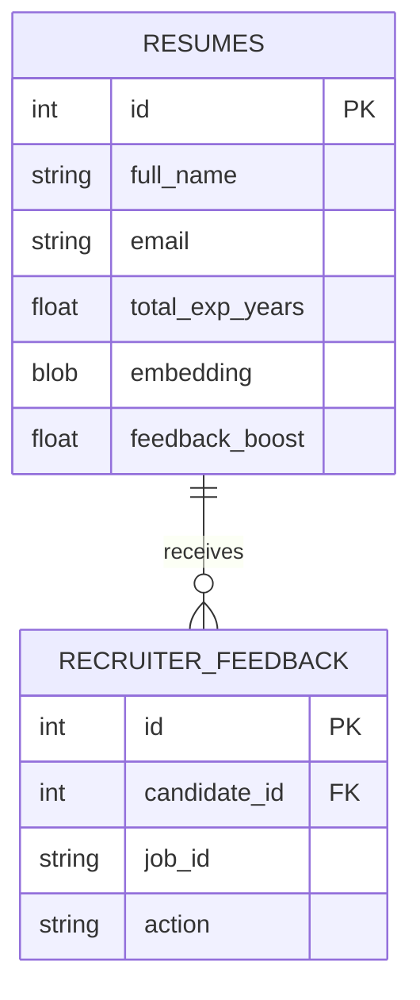

### ⚖️ Pros & Cons
| Pros ✅ | Cons ❌ |
| :--- | :--- |
| Deep semantic understanding far outperforms keyword ATS filters. | In-memory NumPy cosine similarity requires a vector DB at massive scale. |
| Strict MIME validation blocks disguised malicious file uploads. | Relies on external OpenAI API availability for structured parsing. |

### ⚠️ Limitations, Bugs & Vulnerabilities
- **Token Limits:** Extremely long multi-page academic CVs can exceed prompt token windows.
- **SQLite Concurrency:** High concurrent write loads require migration to PostgreSQL + `pgvector` or Qdrant.

### 🔮 Future Updates
- [ ] Migrate vector search to Qdrant/Milvus and add Celery/Redis async ingestion queues.
- [ ] Add local Ollama (Llama 3) support for air-gapped enterprise deployments.

---
---

# 6. ✍️ AI-Powered Signature Verifier (Baseline & Multi-Sample Enterprise)


A biometric handwritten signature authentication suite powered by **Siamese Convolutional Neural Networks (CNN)** and **OpenCV**. Includes both a lightweight single-sample prototype and an enterprise multi-sample versioned REST API (`/api/v1/verify`) with GPU VRAM growth management.

### 🎯 Purpose & Use Cases
- **Purpose:** Combat handwritten signature forgery in banking, legal agreements, and administrative workflows using automated 128-dimensional feature embedding comparison.
- **Use Cases:** Banking check verification, legal contract authentication, and microservice biometric verification APIs.

### ✨ Key Features
- **Multi-Sample Enrollment:** Registers 3–5 signature variations per user to capture natural handwriting variance and reduce false rejections.
- **Smart OpenCV Preprocessing:** Grayscale conversion, Otsu binarization, bounding-box whitespace cropping, and normalization (`220x155`).
- **Versioned REST API & UI:** Responsive Bootstrap 5 web dashboard alongside `/api/v1/users` and `/api/v1/verify` JSON endpoints.

### 📂 File Structure
```text
06-signature-verifier-suite/
├── baseline-single-sample/          # Single reference image prototype
└── enterprise-multi-sample-api/     # Multi-sample One-to-Many DB + REST API
    ├── app.py
    ├── test_api.py
    ├── static/uploads/
    ├── templates/
    └── utils/
        ├── preprocessing.py
        └── siamese.py
```

### ⚙️ Requirements, Installation & Setup
- **Requirements:** Python `3.8+`, optional CUDA GPU.
```bash
cd 06-signature-verifier-suite/enterprise-multi-sample-api
python -m venv env
env\Scripts\activate
pip install flask flask-sqlalchemy tensorflow opencv-python numpy werkzeug requests
python app.py
# Open http://127.0.0.1:5000
```

### 📊 System Architecture (DFD & ER Diagrams)

#### Data Flow Diagram (Level 1 DFD)
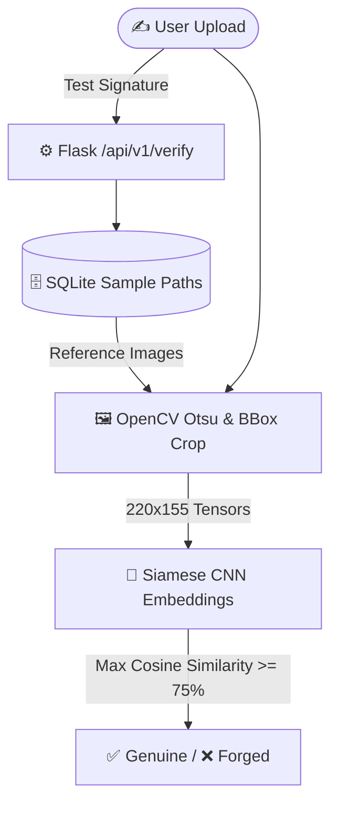

#### Entity-Relationship (ER) Diagram
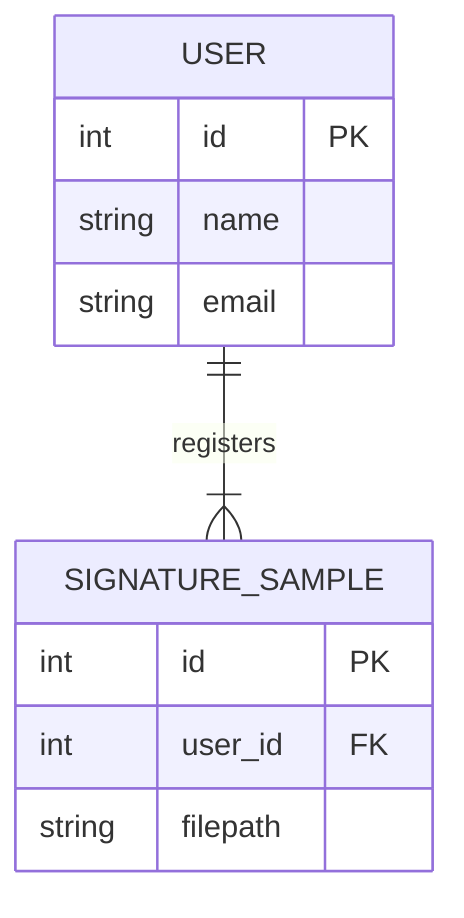

### ⚖️ Pros & Cons
| Pros ✅ | Cons ❌ |
| :--- | :--- |
| Multi-sample max-match scoring handles natural handwriting drift. | Accuracy depends heavily on custom-trained `.h5` dataset weights. |
| Otsu thresholding removes paper shadows and background noise. | Storing multiple raw signature images increases disk footprint. |

### ⚠️ Limitations, Bugs & Vulnerabilities
- **Camera Distortion:** Extreme perspective angles or blurry mobile photos can degrade contour bounding boxes.
- **Security Hardening Needed:** Production deployment requires adding an `AuditLog` table, HTML5 `<canvas>` drawing pad, and screen moiré anti-spoofing checks.

### 🔮 Future Updates
- [ ] Add an interactive HTML5 `<canvas>` signature pad and Grad-CAM visual stroke heatmaps.
- [ ] Implement verification audit trail logging and moiré pattern anti-spoofing detection.

---
---

# 7. 📂 Struct2Project Pro (Automated Architecture Scaffolder)


A developer productivity tool built with **Streamlit** and Python that transforms any Markdown ASCII folder tree structure into a real, scaffolded local directory hierarchy—complete with enterprise Django boilerplate and cryptographically generated `SECRET_KEY` values.

### 🎯 Purpose & Use Cases
- **Purpose:** Eliminate repetitive manual folder creation and boilerplate setup when starting complex backend architectures.
- **Use Cases:** Rapid Django/Python project scaffolding, turning AI-generated directory trees into real files instantly, and packaging standalone `.exe` dev tools.

### ✨ Key Features
- **Native Drive & Folder Picker:** Uses `tkinter` system dialogs to browse local drives (`C:`, `D:`, `E:`) directly from a Streamlit UI.
- **Smart Markdown Comment Stripper:** Cleans inline comments (e.g., `# Core logic`) and box-drawing characters (`├──`, `└──`) automatically.
- **Cryptographic Secret Injection:** Generates unique random `SECRET_KEY` strings via Python's `secrets` module during scaffolding.

### 📂 File Structure
```text
07-struct2project-pro/
├── .streamlit/config.toml   # Custom UI theme configuration
├── TK_GUI.py                # Core parser, native folder dialog & scaffolding engine
├── requirements.txt         # streamlit>=1.32.0
└── README.md
```

### ⚙️ Requirements, Installation & Setup
- **Requirements:** Python `3.8+`, `streamlit`.
```bash
cd 07-struct2project-pro
python -m venv env
env\Scripts\activate
pip install streamlit
streamlit run TK_GUI.py
# Open http://localhost:8501
```

### 📊 System Architecture (DFD & ER Diagrams)

#### Data Flow Diagram (Level 1 DFD)
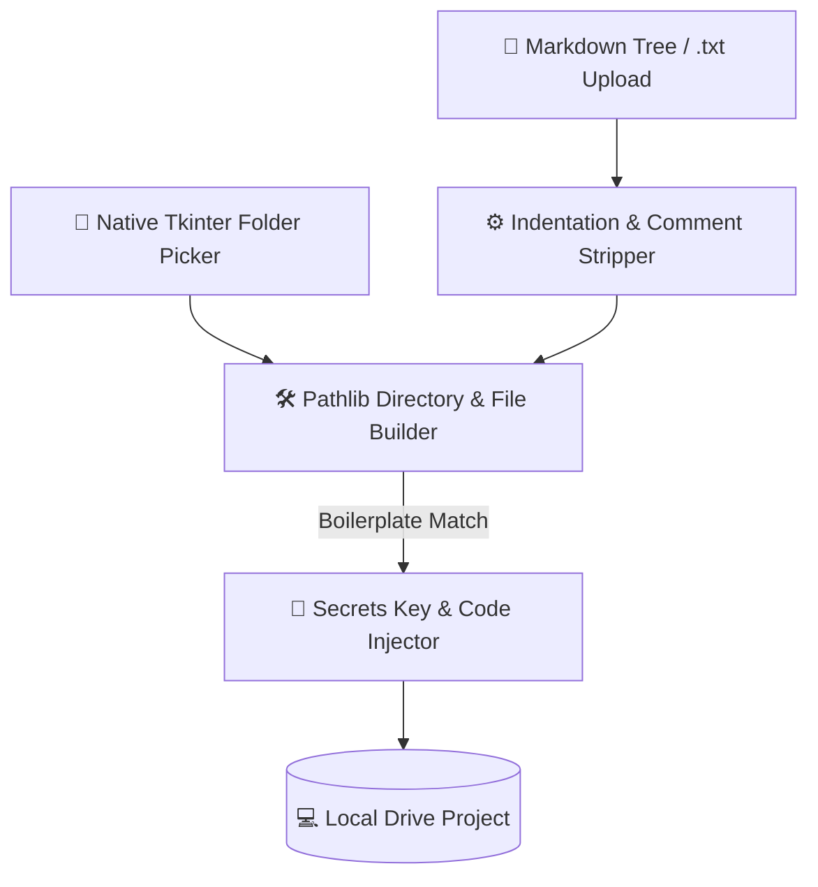

#### Entity-Relationship (ER) Diagram
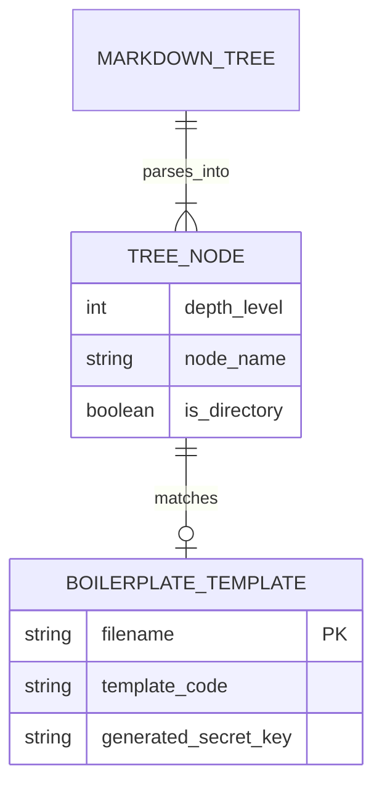

### ⚖️ Pros & Cons
| Pros ✅ | Cons ❌ |
| :--- | :--- |
| Turns any text tree into a working directory in under 1 second. | Designed for local desktop execution rather than remote cloud hosting. |
| Easily packaged into a standalone Windows `.exe` via PyInstaller. | Relies on consistent indentation spacing in the input Markdown tree. |

### ⚠️ Limitations, Bugs & Vulnerabilities
- **Indentation Sensitivity:** Mixed tabs and irregular spaces in poorly formatted Markdown trees can misalign parent-child folder nesting.

### 🔮 Future Updates
- [ ] Add built-in boilerplate templates for FastAPI, React, Next.js, and Flutter.
- [ ] Add a live interactive tree preview before writing files to disk.

---
---

## 🤝 Contributing to This Repository

Contributions, bug reports, and feature enhancements across any of the 7 projects are warmly welcomed!

1. **Fork the Repository:** `https://github.com/alok-kumar8765`
2. **Create a Feature Branch:**
   ```bash
   git checkout -b feature/project-enhancement
   ```
3. **Commit Your Changes:**
   ```bash
   git commit -m "feat(expression-player): add ONNX runtime inference backend"
   ```
4. **Push to Your Branch:**
   ```bash
   git push origin feature/project-enhancement
   ```
5. **Open a Pull Request** detailing which project folder you updated and why.

---

## 🙏 Acknowledgments & Support

- Special thanks to the open-source communities behind **Python, TensorFlow, MediaPipe, DeepFace, OpenCV, FastAPI, Flask, Streamlit, Three.js,** and **Pygame**.
- Architected, developed, and maintained with ❤️ by **Alok Kumar Kaushal**.

⭐ **If you found any of these projects useful, educational, or inspiring, please give this repository a Star on GitHub!**

🔗 **GitHub Profile:** [@alok-kumar8765](https://github.com/alok-kumar8765)