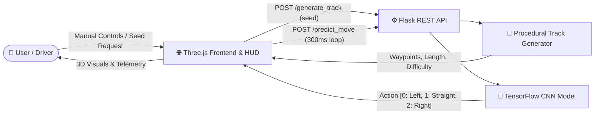
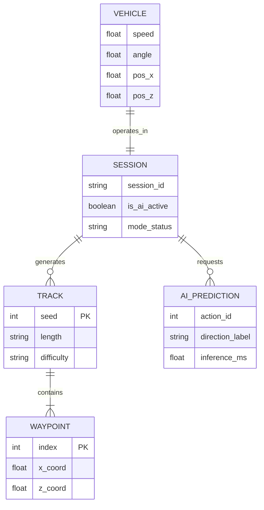

# 🏎️ AI Racing Track Generator & 3D Autonomous Simulation


A full-stack 3D autonomous racing simulation combining a **Python/TensorFlow** AI backend with an interactive **Three.js/WebGL** frontend. Procedurally generate endless race tracks using random seeds, drive manually via an interactive HUD, or toggle **AI Auto-Drive** to let a Convolutional Neural Network (CNN) take the wheel in real time.

---

## 📑 Table of Contents
- [🎯 Purpose & Use Cases](#-purpose--use-cases)
- [✨ Key Features](#-key-features)
- [📂 File Structure](#-file-structure)
- [📊 System Architecture (DFD & ER Diagrams)](#-system-architecture-dfd--er-diagrams)
- [⚙️ Requirements](#️-requirements)
- [🚀 Installation & Setup](#-installation--setup)
- [⚖️ Pros & Cons](#️-pros--cons)
- [⚠️ Limitations, Bugs & Vulnerabilities](#️-limitations-bugs--vulnerabilities)
- [🔮 Future Updates](#-future-updates)
- [🤝 Contributing](#-contributing)
- [🙏 Acknowledgments & Support](#-acknowledgments--support)

---

## 🎯 Purpose & Use Cases
The primary purpose of this project is to bridge **Deep Learning (TensorFlow)** and **3D Browser Graphics (Three.js)** inside a lightweight, accessible local web environment (`localhost:5000`). 

**Common Use Cases:**
* **AI & ML Prototyping:** Testing real-time neural network inference loops without needing heavy desktop game engines like Unreal or Unity.
* **Procedural Content Generation (PCG) Study:** Demonstrating how seeded mathematical splines (`CatmullRomCurve3`) generate infinite, closed-loop 3D environments.
* **Educational Demos:** Visualizing how frontend telemetry communicates with a Python machine learning backend via REST APIs.

---

## ✨ Key Features
* **Procedural 3D Track Generation:** Uses seeded NumPy trigonometry to generate unique closed-loop tracks with dynamic lengths and difficulty ratings.
* **Interactive 3D Environment:** Built with Three.js featuring real-time lighting, dynamic chase camera, physics-based acceleration/friction, and a 3D sports car model.
* **AI Auto-Drive Mode:** One-click toggle that hands vehicle steering over to a TensorFlow Sequential CNN (`Conv2D` $\rightarrow$ `Flatten` $\rightarrow$ `Dense` $\rightarrow$ `Softmax`).
* **Real-Time Telemetry Dashboard:** Includes a live KM/H speedometer, lap indicator, mode status, and a dynamic 2D HTML5 Canvas minimap.
* **Dual Control Scheme:** Supports both keyboard controls (`WASD` / `Arrow Keys`) and on-screen clickable D-Pad buttons.

---

## 📂 File Structure
```text
ai_racing_app/
│
├── app.py                  # Flask server, TensorFlow CNN model & procedural track generator
├── README.md               # Project documentation
└── templates/
    └── index.html          # Three.js 3D renderer, physics loop, HUD & AI polling logic
```

---

## 📊 System Architecture (DFD & ER Diagrams)

### Data Flow Diagram (DFD - Level 1)


### Entity-Relationship (ER) Data Model
*Note: While this application currently operates in-memory without a persistent SQL database, the logical data entities flow as follows:*



---

## ⚙️ Requirements
* **Operating System:** Windows 10/11, macOS, or Linux
* **Python Version:** Python `3.9` – `3.11`
* **Browser:** Modern WebGL-enabled browser (Chrome, Edge, Firefox, Brave)
* **Python Libraries:**
  * `flask`
  * `numpy` (`<2.0` recommended for TensorFlow/Pandas binary compatibility)
  * `tensorflow`

---

## 🚀 Installation & Setup

### 1. Clone the Repository
```bash
git clone https://github.com/alok--kumar8765/ai-racing-simulation.git
cd ai-racing-simulation
```

### 2. Create & Activate a Virtual Environment (Recommended)
**Windows:**
```bash
python -m venv env
env\Scripts\activate
```
**macOS / Linux:**
```bash
python3 -m venv env
source env/bin/activate
```

### 3. Install Dependencies
```bash
pip install flask tensorflow "numpy<2.0"
```

### 4. Run the Application
```bash
python app.py
```

### 5. Launch in Browser
Open your browser and navigate to:
```text
http://localhost:5000
```

---

## ⚖️ Pros & Cons

| Pros ✅ | Cons ❌ |
| :--- | :--- |
| **Zero Heavy Engine Overhead:** Runs directly in a browser without installing Unity or Unreal Engine. | **Untrained AI Weights:** Currently uses an untrained CNN, resulting in stochastic/random steering in AI mode. |
| **Infinite Replayability:** Seeded track generation creates a brand-new circuit with a single click. | **Network Latency:** Polling `/predict_move` over HTTP every 300ms introduces slight steering delay compared to WebSockets. |
| **Clean Full-Stack Separation:** Decouples Python ML logic cleanly from JavaScript 3D rendering. | **Basic Collision Physics:** Car is not physically constrained to road boundaries (can drive off-track onto grass). |

---

## ⚠️ Limitations, Bugs & Vulnerabilities
1. **Untrained Neural Network (Limitation):** `build_ai_model()` compiles the CNN architecture but does not load pre-trained `.h5` weights, meaning AI Auto-Drive outputs random decisions based on dummy frame tensors.
2. **NumPy / Pandas Binary Incompatibility (Known Bug):** Upgrading NumPy to `2.x` alongside older TensorFlow/Keras builds may trigger `ValueError: numpy.dtype size changed`. Fix by pinning `"numpy<2.0"`.
3. **Debug Mode Exposure (Security Vulnerability):** `app.run(debug=True)` is enabled for local development. **Never deploy to a public server with `debug=True`**, as it exposes the interactive Werkzeug debugger to arbitrary code execution.
4. **No Input Rate-Limiting:** Rapidly clicking "New Track" or spamming `/predict_move` can spike CPU usage during TensorFlow inference.

---

## 🔮 Future Updates
- [ ] **Real-Time Canvas Frame Capture:** Stream actual WebGL `<canvas>` pixel data (`128x128x3`) to the Python backend instead of dummy NumPy arrays.
- [ ] **Reinforcement Learning / Behavioral Cloning:** Record human driving sessions to train the CNN (`model.fit()`) so the AI genuinely learns to stay on the asphalt.
- [ ] **WebSockets Integration (`Flask-SocketIO`):** Replace HTTP polling with low-latency bidirectional WebSockets for smoother 60 FPS AI steering.
- [ ] **Track Boundaries & Lap Timer:** Add off-road friction penalties, checkpoint gates, and a persistent leaderboard.

---

## 🤝 Contributing
Contributions, issues, and feature requests are welcome!
1. Fork the Project (`https://github.com/alok--kumar8765`)
2. Create your Feature Branch (`git checkout -b feature/AmazingFeature`)
3. Commit your Changes (`git commit -m 'Add some AmazingFeature'`)
4. Push to the Branch (`git push origin feature/AmazingFeature`)
5. Open a Pull Request

---

## 🙏 Acknowledgments & Support
* Built with **TensorFlow**, **Flask**, and **Three.js**.
* Developed by **[Alok Kumar](https://github.com/alok--kumar8765)**.

⭐ **If you found this project helpful or interesting, please consider giving it a Star on GitHub!**