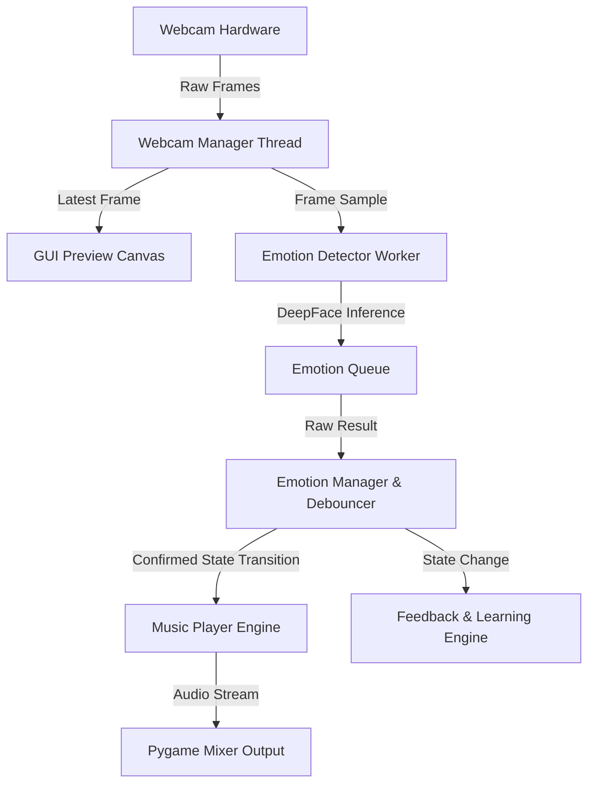
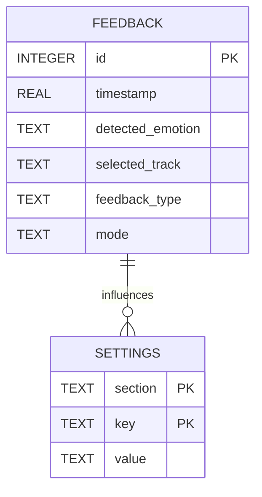

# 🎵 Expression Player - AI-Powered Emotion-Based Music Companion

[](https://github.com/alok--kumar8765/expression-player/stargazers)
[](https://github.com/alok--kumar8765/expression-player/network/members)
[](https://github.com/alok--kumar8765/expression-player/issues)
[](https://www.python.org/)
[](https://opensource.org/licenses/MIT)

---

## 📖 Table of Contents
1. [About & Purpose](#-about--purpose)
2. [Key Features](#-key-features)
3. [Technology Stack](#️-technology-stack)
4. [File Structure](#-file-structure)
5. [System Requirements](#-system-requirements)
6. [Installation & Setup](#-installation--setup)
7. [Data Flow Diagram (DFD)](#-data-flow-diagram-dfd)
8. [Entity-Relationship (ER) Diagram](#-entity-relationship-er-diagram)
9. [Pros & Cons](#-pros--cons)
10. [Limitations](#-limitations)
11. [Bugs & Vulnerabilities](#-bugs--vulnerabilities)
12. [Future Roadmap](#-future-roadmap)
13. [Contributing](#-contributing)
14. [Acknowledgments & Star](#-acknowledgments--star)

---

## 🎯 About & Purpose
**Expression Player** is an advanced, production-grade desktop application that bridges computer vision, affective computing, and media playback. 

**Purpose:** Traditional music players require manual track selection, which can be cumbersome during focused work sessions, driving, or emotional transitions. Expression Player solves this by leveraging real-time edge AI to read facial expressions via a webcam, analyze dominant emotions (Happy, Sad, Angry, Surprise, Neutral), apply strict debounce hysteresis filtering, and intelligently switch music tracks to match or elevate the user's mood.

---

## ✨ Key Features
- **Real-Time Edge AI Analysis:** Local DeepFace facial emotion detection without streaming video footage to external servers.
- **Intelligent Hysteresis Debouncing:** Eliminates rapid song restarting caused by blinking, yawning, or detection noise through rolling windows and timer thresholds.
- **Modern Glassy Dark UI:** Built with custom-styled Tkinter and ttk widgets featuring clean card layouts and a unified slate dark theme.
- **Preference Learning Engine:** SQLite-backed user feedback loop (Thumbs Up/Down) that adapts recommendations over time.
- **Modular Architecture:** Clean separation of concerns with dedicated providers and real-world extension stubs.
- **Real-World Extensions:** Includes structural foundations for **Driver Fatigue Monitoring**, **Workplace Stress Interventions**, **Accessibility/Assistive Cues**, and a **Local Gaming WebSocket/JSON API**.

---

## 🛠️ Technology Stack
* **Language:** Python 3.10+
* **Computer Vision:** OpenCV (`cv2`) & DeepFace
* **Audio Engine:** Pygame (`pygame.mixer`)
* **GUI Framework:** Tkinter & ttk (Custom Dark Styling)
* **Storage & Persistence:** SQLite3 & JSON Configuration

---

## 🗂️ File Structure
```text
expression_player/
│
├── main.py                  # Application entry point
├── requirements.txt         # Project dependencies
├── README.md                # Repository documentation
├── config.json              # Global user & app configuration
│
├── assets/                  # Icons and static images
│   ├── icons/
│   └── images/
│
├── music/                   # Local MP3 track library
│   ├── happy/
│   ├── sad/
│   ├── angry/
│   ├── surprise/
│   └── neutral/
│
├── core/                    # Core business logic
│   ├── webcam_manager.py
│   ├── emotion_detector.py
│   ├── emotion_manager.py
│   ├── music_player.py
│   ├── playlist_manager.py
│   ├── feedback_manager.py
│   └── settings_manager.py
│
├── gui/                     # Graphical User Interface panels
│   ├── main_window.py
│   ├── webcam_panel.py
│   ├── emotion_panel.py
│   ├── music_panel.py
│   └── settings_panel.py
│
├── providers/               # Streaming & external API adapters
│   ├── base_provider.py
│   ├── local_provider.py
│   └── spotify_provider.py
│
├── extensions/              # Real-world application extensions
│   ├── driver_monitor.py
│   ├── stress_monitor.py
│   ├── accessibility.py
│   └── gaming_api.py
│
├── database/                # Local persistence store
│   └── feedback.db
│
├── utils/                   # Helper functions and loggers
│   ├── logger.py
│   └── helpers.py
│
└── tests/                   # Automated unit testing suite
    └── test_emotion_manager.py
```

---

## 💻 System Requirements
- **OS:** Windows 10/11, Linux (Ubuntu 20.04+), or macOS.
- **Hardware:** Webcam (built-in or USB), 4GB+ RAM.
- **Python:** Python version 3.10 or higher installed.

---

## 🚀 Installation & Setup

Follow these terminal commands to set up and run the project locally (optimized for Windows & Linux):

1. **Clone the Repository:**
   ```bash
   git clone https://github.com/alok-kumar8765/expression-player.git
   cd expression-player
   ```

2. **Create and Activate a Virtual Environment:**
   ```bash
   # Windows
   python -m venv env
   env\Scripts\activate

   # Linux / macOS
   python3 -m venv env
   source env/bin/activate
   ```

3. **Install Dependencies:**
   ```bash
   pip install --upgrade pip
   pip install -r requirements.txt
   ```

4. **Organize Music Library:**
   Place your `.mp3` or `.wav` audio files into their respective emotion folders:
   - `music/happy/`
   - `music/sad/`
   - `music/angry/`
   - `music/surprise/`
   - `music/neutral/`

5. **Run the Application:**
   ```bash
   python main.py
   ```

---

## 📊 Data Flow Diagram (DFD)



---

## 🗄️ Entity-Relationship (ER) Diagram



---

## ⚖️ Pros & Cons

### **Pros:**
- **Complete Privacy:** 100% local edge AI execution; no video frames or face templates leave your device.
- **Robust Architecture:** Multithreaded structure prevents GUI freezing during heavy deep learning inference.
- **Zero-Glitch Playback:** Advanced hysteresis debouncing prevents annoying song re-triggering.
- **Extensible Design:** Modular layout makes adding streaming APIs or extensions straightforward.

### **Cons:**
- **Resource Intensive:** DeepFace can consume significant CPU/RAM without dedicated GPU acceleration.
- **Lighting Sensitivity:** Poor ambient lighting can reduce emotion detection confidence scores.
- **Hardware Dependency:** Requires an active, unobstructed webcam feed.

---

## ⚠️ Limitations
1. **Affective Inference Approximation:** Facial expressions reflect outward muscle movements, not necessarily a user's internal emotional state.
2. **Single-Face Focus:** Designed primarily for single-user desktop interaction in front of a webcam.
3. **Offline Default:** Advanced online catalog searching requires explicit API token configuration (e.g., Spotify Developer credentials).

---

## 🐞 Bugs & Vulnerabilities
- **Cold-Start Latency:** The first DeepFace analysis frame may take 2–3 seconds to load model weights into memory.
- **Audio Codec Warnings:** Certain compressed `.mp3` bitrates may trigger Pygame mixer decoding warnings on specific Linux distributions.
- **Plain-Text SQLite Storage:** Local feedback history is stored unencrypted in `feedback.db`.

---

## 🗺️ Future Roadmap
- [ ] Integration with Spotify Web API for dynamic playlist recommendations based on valence and tempo.
- [ ] Lightweight ONNX Runtime and MediaPipe model porting for 60 FPS mobile/laptop execution.
- [ ] Remote photoplethysmography (rPPG) contactless heart rate estimation extension.
- [ ] Multi-face detection and crowd emotion averaging.

---

## 🤝 Contributing
Contributions, issues, and feature requests are welcome! 
Feel free to check the [issues page](https://github.com/alok--kumar8765/expression-player/issues).

1. Fork the Project (`https://github.com/alok--kumar8765/expression-player/fork`)
2. Create your Feature Branch (`git checkout -b feature/AmazingFeature`)
3. Commit your Changes (`git commit -m 'Add some AmazingFeature'`)
4. Push to the Branch (`git origin push feature/AmazingFeature`)
5. Open a Pull Request

---

## 🙏 Acknowledgments & Star
Developed with ❤️ by **Alok Kumar**. 
If you found this project helpful, innovative, or inspiring, please consider giving it a ⭐ on GitHub!

**GitHub:** [@ALOK KUMAR KAUSHAL](https://github.com/alok-kumar8765)