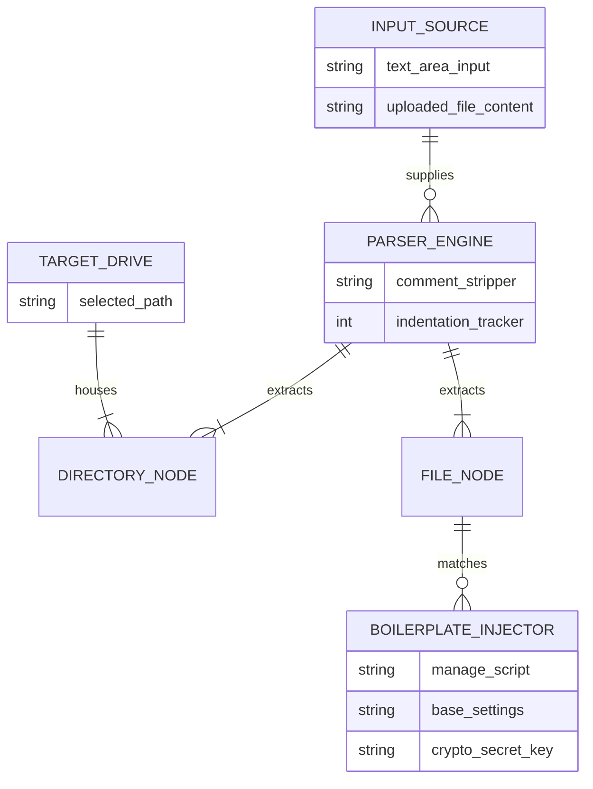
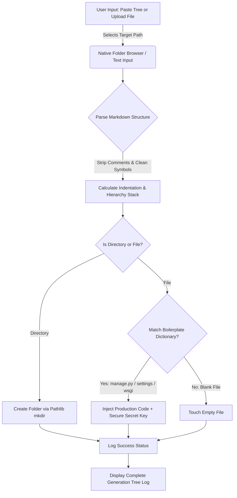

# 📂 Struct2Project Pro

[](https://streamlit.io)
[](https://www.python.org/)
[](https://opensource.org/licenses/MIT)
[](CONTRIBUTING.md)
[](https://github.com/yourusername/struct2project-pro)

> **Transform any Markdown folder tree structure or uploaded file into a fully scaffolded local project directory instantly—complete with enterprise-grade boilerplate code and unique secure keys!**

---

## 📑 Table of Contents
- [About The Project](#-about-the-project)
- [Key Features](#-key-features)
- [Use Cases](#-use-cases)
- [File Structure](#-file-structure)
- [System Architecture & Diagrams](#-system-architecture--diagrams)
  - [Entity-Relationship (ER) Diagram](#entity-relationship-er-diagram)
  - [Data Flow Diagram (DFD)](#data-flow-diagram-dfd)
- [Installation Guide](#-installation-guide)
- [Setup & Configuration](#-setup--configuration)
- [How to Use](#-how-to-use)
- [Packaging into a Standalone `.exe`](-packaging-into-a-standalone-exe)
- [Pros and Cons](#-pros-and-cons)
- [Limitations](#-limitations)
- [Future Updates & Roadmap](#-future-updates--roadmap)
- [Contributing](#-contributing)
- [Acknowledgments & Star Us](#-acknowledgments--star-us)

---

## 🌟 About The Project
**Struct2Project Pro** is an advanced developer tool built with **Streamlit** and Python designed to bridge the gap between architectural project planning (Markdown tree structures) and local drive implementation. 

Instead of manually creating nested directories, configuration files, and typing repetitive boilerplate code for frameworks like Django, Struct2Project Pro parses markdown trees, filters out inline comments automatically, allows native directory browsing across local drives (C:, D:, E:), injects production-grade code configurations, and auto-generates cryptographically secure keys (`SECRET_KEY`) on the fly.

---

## ✨ Key Features
- **Native Folder Browser Integration:** Select your target local drive and directory using native system dialogs (`tkinter`) instead of manual path typing.
- **Dual Input Modes:** Paste your folder structure markdown directly into the text area or upload `.txt` / `.md` configuration files.
- **Smart Comment Stripper:** Automatically removes inline Markdown comments (e.g., `# Project settings`) to prevent path creation errors.
- **Enterprise Django Scaffolding:** Automatically builds complex layered structures (e.g., split settings for base, development, and production).
- **Dynamic Secret Key Generation:** Generates a unique, cryptographically secure random `SECRET_KEY` via Python's `secrets` module for every generated project.
- **Standalone `.exe` Support:** Easily bundle the app into a desktop executable using PyInstaller.

---

## 💼 Use Cases
1. **Rapid Enterprise Scaffolding:** Quickly scaffold massive production-ready architectures (like School ERPs, E-commerce systems) with pre-configured apps and modular settings.
2. **Academic & Team Collaboration:** Share text-based architecture templates that teammates can instantly materialize on their local drives.
3. **Boilerplate Automation:** Eliminate repetitive file creation tasks for standard backend frameworks.

---

## 📂 File Structure
```text
struct2project/
│
├── .streamlit/
│   └── config.toml          # Custom theme & UI configurations
├── TK_GUI.py                # Core application script & parsing logic
├── requirements.txt         # Project Python dependencies
└── README.md                # Project documentation

```

---

## 📊 System Architecture & Diagrams

### Entity-Relationship (ER) Diagram

*Illustrating the core data mapping and file generation entities within the application.*



### Data Flow Diagram (DFD - Level 1)

*Tracing how folder hierarchies and files are synthesized on the local file system.*



---

## ⚙️ Installation Guide

Follow these steps to set up the project locally on your machine:

1. **Clone the repository:**
```bash
git clone [https://github.com/yourusername/struct2project-pro.git](https://github.com/alok-kumar8765/struct2project-pro.git)
cd struct2project-pro

```


2. **Create a virtual environment:**
```bash
python -m venv venv
# On Windows:
venv\Scripts\activate
# On macOS/Linux:
source venv/bin/activate

```


3. **Install dependencies:**
```bash
pip install -r requirements.txt

```


---

## 🚀 Setup & Configuration

Ensure your `requirements.txt` contains the required core packages:

```text
streamlit>=1.32.0

```

*(Note: `tkinter`, `pathlib`, `os`, and `secrets` are built-in Python standard libraries).*

---

## 🖥️ How to Use

1. Run the application via Streamlit:
```bash
streamlit run TK_GUI.py

```


2. Open your browser at `http://localhost:8501`.
3. In the UI:
* Click **🔍 Browse Folder** to pick your target drive and workspace folder.
* Paste your project tree structure or upload a `.txt`/`.md` file.
* Toggle the boilerplate checkbox to inject professional templates and secure keys.
* Click **🚀 Generate Project on Selected Drive**!


---

## 📦 Packaging into a Standalone `.exe`

To run this app as a standalone Windows desktop application without using command-line commands:

1. Install PyInstaller:
```bash
pip install pyinstaller

```


2. Create a launcher script named `run.py`:
```python
import sys
from streamlit.web.cli import main

if __name__ == "__main__":
    sys.argv = [
        "streamlit",
        "run",
        "TK_GUI.py",
        "--global.developmentMode=false",
    ]
    sys.exit(main())

```


3. Run the PyInstaller build command:
```bash
pyinstaller --noconsole --onedir --add-data "venv/Lib/site-packages/streamlit;streamlit" run.py

```


4. Navigate to the `dist/run/` folder and double-click `run.exe`!

---

## ⚖️ Pros and Cons

### Pros

* **Zero Configuration Setup:** Works out of the box with built-in standard Python modules.
* **Cross-Drive Flexibility:** Native directory selection allows scaffolding directly onto any connected local drive.
* **Security First:** Automatically generates unique cryptographic secrets per build.

### Cons

* **Local Scope Only:** Designed specifically for local machine execution (cannot remote-scaffold server environments directly through a web browser without local server access).

---

## ⚠️ Limitations

* Relies on correct indentation formatting (tabs or 4-space increments) in the markdown tree to calculate parent-child folder relationships accurately.

---

## 🔮 Future Updates & Roadmap

* [ ] **Custom Framework Templates:** Add support for React, FastAPI, Node.js, and Flutter boilerplate structures.
* [ ] **Interactive Tree Visualizer:** Preview the parsed folder structure in an interactive UI tree component before generation.
* [ ] **Custom File Content Editor:** Add custom code snippets for any user-defined file type inside the markdown.

---

## 🤝 Contributing

Contributions, issues, and feature requests are welcome!
Feel free to check the [issues page](https://www.google.com/search?q=https://github.com/alok-kumar8765/struct2project-pro/issues).

1. Fork the Project
2. Create your Feature Branch (`git checkout -b feature/AmazingFeature`)
3. Commit your Changes (`git commit -m 'Add some AmazingFeature'`)
4. Push to the Branch (`git push origin feature/AmazingFeature`)
5. Open a Pull Request

---

## 🙏 Acknowledgments & Star Us

If this tool saved you hours of manual project setup, please give it a **⭐ Star** on GitHub!

*Built with ❤️ by [ALOK KUMAR KAUSHAL](https://github.com/alok-kumar8765).*
